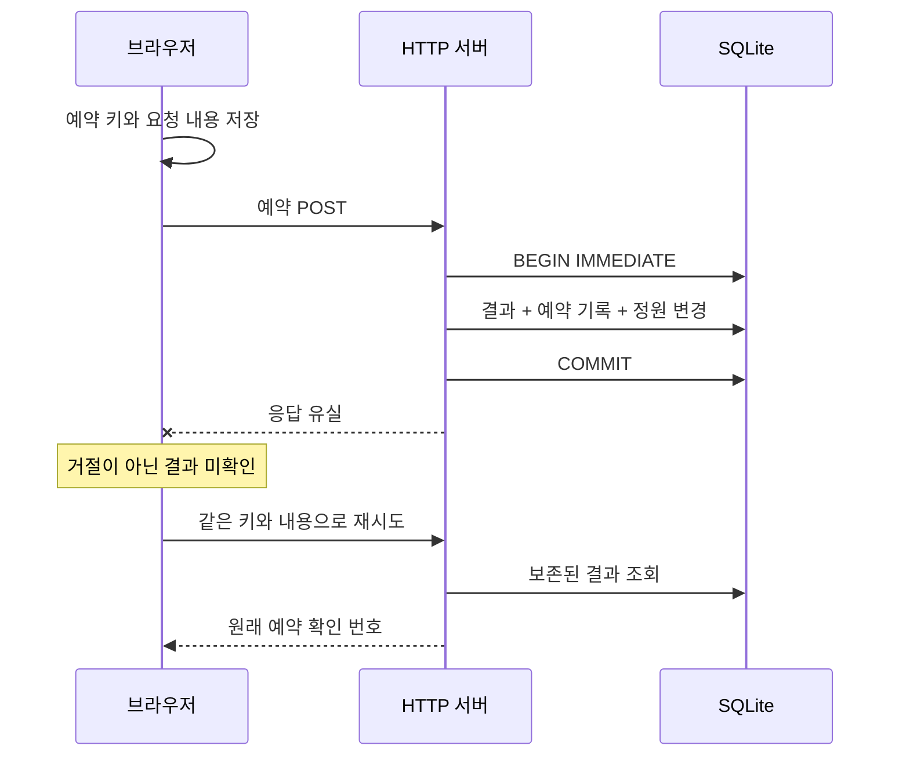

# 결과를 모르는 경계에서 내린 판단

[English](design.md) · [실행하기](../README.ko.md)

## 서로 다를 수 있는 세 가지 사실

1. **사용자의 의도**: 한 자리를 예약한다.
2. **클라이언트의 관측**: 사용할 수 있는 응답을 받지 못했다.
3. **서버의 영속 결과**: 예약 한 건이 커밋되었다.

타임아웃은 두 번째 사실을 바꿉니다. 세 번째 사실을 결정하지 않습니다. 이를 예약 거절로 처리하면, 이미 완료된 예약을 두고 새 예약을 시작할 수 있습니다.

## 왜 보내기 전에 저장하는가?

키가 fetch 콜백 안에만 있으면 새로고침으로 복구에 필요한 식별자를 잃을 수 있습니다. 첫 POST 전에 예약 키와 요청 내용을 저장하고, URL에 복구용 식별자를 남깁니다. 저장할 수 없으면 전송하지 않습니다.

URL은 복구용 식별자이며 인증 수단이 아닙니다. 계정이 없는 로컬 실험입니다. 서비스로 배포하려면 인증된 사용자와 예약의 소유 관계, 식별자 설계와 개인정보 처리를 별도로 다뤄야 합니다.

같은 복구 링크를 연 두 탭은 하나의 예약 요청을 재사용합니다. 각각 새로 만든 요청은 서로 다른 구매입니다. `localStorage`가 탭 사이의 키 생성을 원자적으로 조정한다고 주장하지 않습니다. 로컬에 저장한 예약 정보가 없거나 손상되면 조회만 허용합니다. 검증된 서버의 최종 결과로 요청 내용을 복구할 수 있지만, “아직 보이지 않는다”는 조회 결과만으로는 복구할 수 없습니다.

## 왜 식별자가 두 개 필요한가?

**화면의 요청 순번**은 클라이언트 컨트롤러와 수명을 함께합니다. 오래된 조회 응답이 새 예약 완료 화면을 덮는 것을 막습니다. **예약 키**는 HTTP 요청과 새로고침을 넘어 유지되며 서버의 영속 결과를 식별합니다.

재시도할 때마다 예약 키를 바꾸면 어느 문제도 해결하지 못합니다. 예약 키만 유지해도 늦게 도착한 `404`가 더 새로운 확인 결과를 덮을 수 있습니다. 서로 다른 두 수명이 모두 필요합니다.

## 예약 결과는 왜 보존하는가?

서버는 기존 예약이나 정원을 읽기 전에 쓰기 트랜잭션을 시작합니다. 같은 키와 내용이면 원래 결과를 반환하고, 내용이 다르면 충돌로 처리합니다. 예약 완료와 정원 부족에 따른 거절 모두 최종 결과로 보존합니다.

예약을 확정할 때는 예약 결과, 예약 기록, 정원 차감이 한 트랜잭션에서 커밋됩니다. 지연 검사하는 외래 키가 완료된 요청과 예약 확인 번호를 연결하고, 수정·삭제 방지 트리거가 일반적인 경로로 기록을 바꾸지 못하게 합니다. 별도로 작성한 검사기는 예약 수, 정원 보존, 기록 순서에서 각 판단이 타당했는지 확인합니다.

모든 HTTP 응답을 저장하는 캐시는 아닙니다. 일시적인 저장소 실패는 불확실성이며 보존할 예약 거절이 아닙니다. [Stripe의 문서](https://docs.stripe.com/api/idempotent_requests)에 설명된 응답 재사용 방식과 달리, 이 실험은 모든 응답 대신 예약 결과를 보관합니다.

## 왜 SQLite인가?

별도 인프라 없이 원자적 처리 범위를 살펴보고 재현하기 위해 사용했습니다. 서버 프로세스 두 개도 SQLite의 쓰기 잠금으로 조정할 수 있습니다. 이 선택이 곧 대규모 분산 예약 서비스를 구현했다는 뜻은 아닙니다.

롤백 저널과 `synchronous=FULL`을 사용합니다. 동기식 체크포인트에서 자식 프로세스를 멈춘 뒤 부모가 강제 종료하고, 다른 프로세스가 같은 데이터베이스를 엽니다. 애플리케이션 커밋 전후의 프로세스 종료 복구를 검증합니다. SQLite 내부의 모든 쓰기 단계, 손상된 저장 장치, 정전이나 네트워크 파일시스템을 시험하지는 않습니다. [SQLite의 원자적 커밋 전제](https://sqlite.org/atomiccommit.html)를 참고했습니다.

동기식 SQLite와 제한된 잠금 대기는 Node 이벤트 루프를 막을 수 있습니다. 워커 스레드나 서버형 데이터베이스를 선택하면 실행·운영 특성은 달라지지만 관련 기록을 함께 커밋하고 요청 키를 유지해야 한다는 조건은 남습니다.

## 왜 자동 재시도나 보관 TTL이 없는가?

불확실성을 직접 관찰하도록 각 행동을 드러냈습니다. 실제 자동 재시도에는 횟수·시간 예산, 백오프, 유입 제어가 필요합니다. 재시도 자체도 용량을 소비합니다. 이 실험은 그 값을 추정하지 않습니다.

예약 키의 이력은 계속 보관합니다. 이력을 지우면 충분히 늦게 온 요청이 신규 요청처럼 보일 수 있습니다. 보관 정책에는 복구 가능한 기간과 만료된 식별자에 대한 응답이 필요합니다. 제품 규약 없이 TTL만 추가하면 보장이 약해집니다.

## 이전 결과를 모를 때 새 예약은 왜 별도 행동인가?

앱은 명확한 안내와 함께 별도 예약을 시작하도록 합니다. 새 의도가 의미상 이전 구매와 같은지 시스템이 알아낼 수는 없습니다. “재시도”가 조용히 키를 바꾸면 그 선택이 사용자에게 감춰집니다. 실제 제품은 중복의 비용에 따라 행동을 제한하거나 고객 지원 흐름으로 보낼 수 있습니다.

앱 복귀 신호도 같은 한계를 가집니다. 결과 조회의 계기이며 예약 확인 번호를 만드는 근거가 아닙니다. 브라우저의 대기를 중단해도 서버 트랜잭션이 취소되었다고 말하지 않습니다.

## 실행 근거가 설명할 수 있는 범위

실제 HTTP 관측과 기록 스냅샷을 남깁니다. 프로세스 종료 실험은 실행별 식별자에 연결한 체크포인트, 멈춰 있는 자식 프로세스, 부모의 종료 동작을 사용합니다. 서버 두 개의 실험은 해당 요청들의 결과가 수렴함을 관찰하며, 임의의 실행 이력에 대한 선형화 가능성이나 공정성을 증명하지 않습니다.

검사기는 서버 구현의 분기와 분리되어 있으며 잘못된 기록과 변형한 응답으로 검사 능력을 확인합니다. 성공한 보고서에도 범위가 있습니다. 명시된 시나리오, 관측한 소스 파일과 실행 환경입니다. 형식적 증명이나 변조 불가능한 실행 증명은 아닙니다. 실험 중에는 소스를 변경하지 않아야 합니다.
