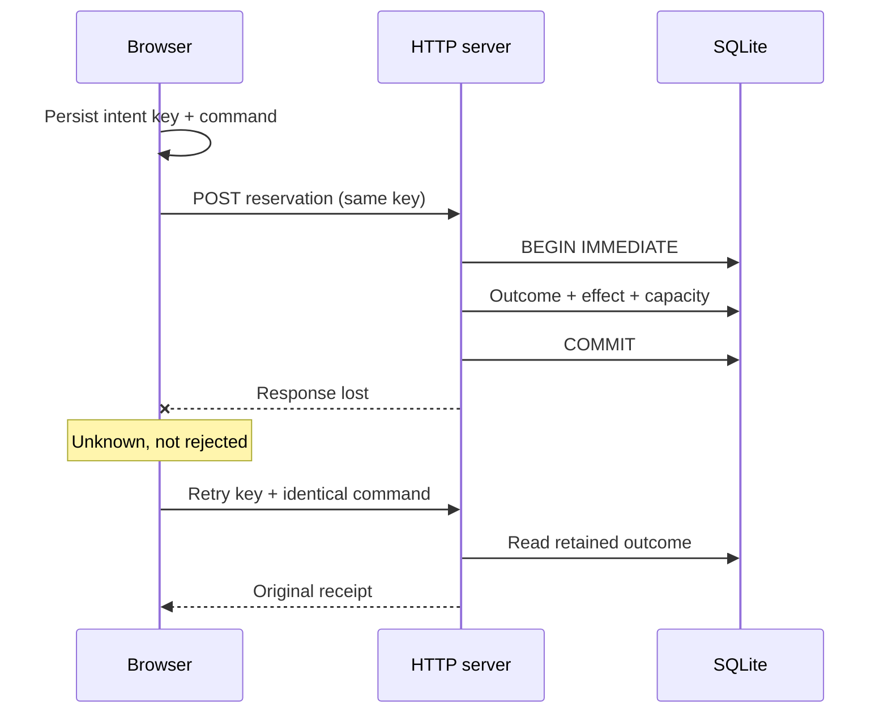

# Decisions at the uncertainty boundary

[한국어](design.ko.md) · [Run the lab](../README.md)

## Three facts that can disagree

1. The **user’s intent**: reserve one place.
2. The **client’s observation**: the request ended without a usable response.
3. The **server’s durable outcome**: one reservation was committed.

A timeout changes the second fact. It does not determine the third. Treating it as failure manufactures permission to issue a new purchase.

## Why persist before sending?

If a new key exists only inside a fetch callback, a reload can destroy the identity needed to recover. The client stores the key and canonical command before the first POST and puts the recovery handle in the URL. It refuses to send when persistence fails.

The URL is a recovery handle, not an authorization mechanism. This local demo has no accounts. A deployed service would need authenticated ownership checks, appropriate opaque identifiers and a deliberate privacy design.

Two tabs with the same recovery link reuse one intent. Two independently created intents remain different purchases. There is no claim that `localStorage` provides atomic cross-tab allocation. Missing or corrupt local context permits lookup only; a validated terminal server outcome can restore the command. An unseen result cannot invent one.

## Why two identifiers?

The **request sequence** expires with a client controller. It prevents an older lookup response from repainting a newer confirmation. The **intent key** survives requests and reloads. It identifies the mutation’s durable outcome.

Replacing the intent key on every retry solves neither problem. Keeping only the intent key also does not prevent a late `404` from overwriting newer knowledge. The client needs both lifetimes.

## Why a retained business outcome?

The server starts a writer transaction before reading the intent or capacity. A replay returns the original semantic outcome; changed command contents conflict. Confirmation and capacity rejection are both terminal, retained outcomes.

The same transaction records the intent, creates its effect and consumes capacity. Deferred foreign keys couple a confirmation to its receipt; immutable-record triggers prevent ordinary update/delete paths from rewriting history. An independent checker verifies effect cardinality, capacity conservation and whether each decision was justified at its journal position.

This is not a cache of every HTTP response. A transient storage failure is uncertainty, not a retained business rejection. [Stripe’s API documentation](https://docs.stripe.com/api/idempotent_requests) describes its own response-replay semantics; this lab intentionally has a narrower domain-outcome contract.

## Why SQLite?

SQLite keeps the atomic boundary inspectable and the experiment reproducible without infrastructure. Two server processes can coordinate through its writer lock. It does not make this a high-throughput distributed reservation service.

The store uses a rollback journal and `synchronous=FULL`. The harness blocks at a synchronous checkpoint, the parent terminates that child, and another process opens the same database. This tests process-death recovery around application commit. It does not test every internal SQLite write step, broken storage, a power outage, or network filesystems. See [SQLite’s atomic commit assumptions](https://sqlite.org/atomiccommit.html).

Synchronous SQLite and a bounded busy timeout can block the Node event loop. That tradeoff is explicit here; moving to worker threads or a server database would change scheduling and operational behavior, not remove the need for coupled records and a stable intent.

## Why no automatic retry loop or retention TTL?

The lab exposes each action so the uncertainty is observable. A production retry policy also needs budgets, backoff and admission control; retries themselves consume capacity. This experiment does not estimate those budgets.

Intent history is retained indefinitely. Deleting it changes the guarantee: a sufficiently late request can look new again. A retention policy needs a stated recovery window and a response for expired identities. Adding a TTL without that product contract would make the demo simpler and the guarantee weaker.

## Why allow a new reservation while the old one is unknown?

The app exposes it as a separate action with a clear warning. It cannot infer that the user’s new intent is semantically the old purchase. Silently switching keys on “retry” would hide that choice. A real product could restrict the action or route it through support depending on the cost of duplicates.

An app-return callback is similarly limited: it triggers reconciliation only. Callback parameters are never converted into a receipt, and stopping a browser’s wait never claims to cancel the server transaction.

## What the evidence can establish

Each scenario records real HTTP observations and ledger snapshots. Crashes use a run-bound checkpoint marker, a blocked child and parent-driven termination. The two-process scenario observes convergence for its requests; it does not prove arbitrary-history linearizability or fairness.

The checker is separate from store branches and is tested with deliberately inconsistent records and mutated responses. A green report still has a scope: the declared scenarios, the observed source files and the recorded runtime. It is neither a formal proof nor a tamper-proof attestation. Source should stay quiescent while an experiment runs.
